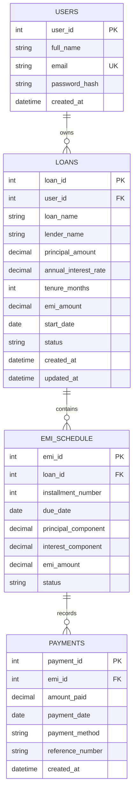

# EMI Management System

> **A Comprehensive, Production-Grade Financial Web Application for Third Year Computer Engineering Web Technology Mini Project**

[](https://www.python.org/)
[](https://flask.palletsprojects.com/)
[](https://www.mysql.com/)
[](https://getbootstrap.com/)
[](https://docs.pytest.org/)

---

## 1. Project Abstract

The **EMI Management System** is a robust, full-stack financial web platform developed to assist personal borrowers in administering multiple credit lines, computing reducing-balance Equated Monthly Instalments (EMIs), automatically generating complete monthly amortization schedules, tracking full and partial repayments, and providing real-time financial reporting with visual analytics.

Traditional personal loan tracking is often dispersed across paper ledgers or fragmented spreadsheets, leading to missed due dates, calculation discrepancies, and lack of visibility into long-term interest commitments. This system solves these issues through a centralized banking-style dashboard engineered with Python (Flask), MySQL, SQLAlchemy ORM, and Bootstrap 5.

---

## 2. Problem Statement

Individual borrowers regularly manage multiple concurrent debt obligations—including home loans, vehicle loans, education loans, and personal financing. Existing personal finance tools either overcomplicate simple EMI tracking by mandating intrusive bank account linkages, or oversimplify it into static calculator prototypes that fail to store persistent payment histories.

There is a critical need for a secure, self-contained, and intuitive web application that:
1. Employs mathematically verified reducing-balance compound interest models.
2. Automates calendar-aware monthly instalment scheduling.
3. Supports flexible partial and multi-transaction repayment logging.
4. Strictly preserves financial audit trails and historical records via atomic database transactions and safe edit policies.

---

## 3. Objectives & Scope

### Objectives
- Deliver an intuitive banking-grade dashboard highlighting active loans, outstanding principal, monthly commitments, and overdue warnings.
- Provide a dual-mode reducing-balance EMI calculator with real-time browser preview and authoritative server-side validation.
- Implement automated schedule generators capable of handling month-end date progression (including February leap year variations) and last-instalment penny reconciliation.
- Ensure strict multi-tenant data isolation preventing unauthorized cross-user queries or modifications.
- Deliver comprehensive visual charts (Chart.js) and sanitized CSV ledger exports.

### Scope
- **Included**: User registration, session-based authentication with secure password hashing (PBKDF2 SHA-256), loan CRUD, automated schedule creation, repayment tracking, partial payment allocation, overdue computation, status badges, reporting, and automated test suites.
- **Excluded**: Direct third-party payment gateway or bank-transfer settlement (as designed for academic simulation and repayment tracking).

---

## 4. Hardware & Software Requirements

### Hardware Requirements
- **Processor**: Intel Core i3 / AMD Ryzen 3 / Apple Silicon (M1/M2/M3) or higher.
- **RAM**: Minimum 4 GB (8 GB recommended).
- **Disk Storage**: At least 500 MB free storage for application code, dependencies, and database files.
- **Display**: Minimum resolution of 1024x768 (responsive design supports mobile, tablet, and desktop).

### Software Requirements
- **Operating System**: macOS (11+), Ubuntu / Debian Linux (20.04+), or Windows 10/11.
- **Runtime**: Python 3.9, 3.10, 3.11, or 3.12.
- **Database Server**: MySQL Server 5.7+ / 8.0+ (or MariaDB 10.3+).
- **Web Browser**: Modern standards-compliant browser (Google Chrome, Mozilla Firefox, Safari, Microsoft Edge).

---

## 5. Technology Stack

| Layer | Technology | Rationale |
| :--- | :--- | :--- |
| **Frontend** | HTML5, CSS3, JavaScript (ES6) | Responsive, lightweight, standards-compliant user interface. |
| **CSS Framework** | Bootstrap 5.3 + Bootstrap Icons | Clean, responsive banking dashboard styling with mobile offcanvas navigation. |
| **Charts** | Chart.js 4.4 | High-performance interactive visualizations (Doughnut, Bar, and Line charts). |
| **Backend Framework** | Python 3 + Flask 3.1 | Modular WSGI web microframework utilizing Blueprints and application factories. |
| **Database** | MySQL Server | Relational database providing ACID transactions, foreign key cascades, and decimal data types. |
| **ORM / Integration** | SQLAlchemy 2.0 / Flask-SQLAlchemy 3.1 / PyMySQL | Declarative models, parameterized SQL execution, and connection pooling. |
| **Security & Auth** | Werkzeug Security + Flask Sessions | NIST-compliant PBKDF2 SHA-256 password hashing, CSRF token validation, HTTPOnly cookies. |
| **Automated Testing** | pytest 8.4 | Unit, integration, and security test automation. |

---

## 6. System Architecture

The project follows a clean **Model-Service-Route-Template (MSRT)** architectural pattern:

```
+-----------------------------------------------------------------------+
|                              CLIENT TIER                              |
|   Web Browser (HTML5, Bootstrap 5, JavaScript ES6, Chart.js, CSS3)    |
+-----------------------------------------------------------------------+
                                   |  HTTP / HTTPS (JSON & Form-Encoded)
                                   v
+-----------------------------------------------------------------------+
|                             ROUTING TIER                              |
|           Flask Blueprints & Authentication / CSRF Middleware         |
|  [auth_routes] [dashboard_routes] [loan_routes] [emi_routes] ...     |
+-----------------------------------------------------------------------+
                                   |  Calls Clean Business Logic
                                   v
+-----------------------------------------------------------------------+
|                             SERVICE TIER                              |
|   - auth_service: Registration, verification, password hashing        |
|   - emi_calculator: Reducing-balance formula, penny reconciliation    |
|   - loan_service: CRUD operations, safe edit policy enforcement       |
|   - emi_schedule_service: Date progression, status evaluations       |
|   - payment_service: Partial/full logging, atomic transactions        |
|   - report_service: Dashboard metrics, Chart.js payloads, CSV export  |
+-----------------------------------------------------------------------+
                                   |  ORM Operations (SQLAlchemy 2.0)
                                   v
+-----------------------------------------------------------------------+
|                              MODEL TIER                               |
|        User  <---1:N--->  Loan  <---1:N--->  EMISchedule  <---1:N---> |
|                                                    Payment            |
+-----------------------------------------------------------------------+
                                   |  TCP / Sockets (PyMySQL)
                                   v
+-----------------------------------------------------------------------+
|                            DATABASE TIER                              |
|                  MySQL Database (emi_management_db)                   |
|               InnoDB Engine, UTF-8 MB4, Cascade Constraints          |
+-----------------------------------------------------------------------+
```

---

## 7. Database Schema & Entity-Relationship (ER) Diagram

The system employs an authoritative relational design utilizing `DECIMAL(12, 2)` types for all financial values to eliminate floating-point rounding errors.

### Mermaid ER Diagram



---

## 8. Financial Formulas & Calculation Logic

### Standard Reducing-Balance EMI Formula

The monthly Equated Monthly Instalment (EMI) is derived as:

$$EMI = P \times r \times \frac{(1 + r)^n}{(1 + r)^n - 1}$$

Where:
- **$P$**: Principal loan amount.
- **$r$**: Monthly interest rate as a decimal:
  $$r = \frac{\text{Annual Interest Rate}}{12 \times 100}$$
- **$n$**: Total repayment tenure in months.

#### Zero-Interest Loan Formula
When Annual Rate = 0%:
$$EMI = \frac{P}{n}$$

### Amortization & Rounding Reconciliation
In real-world banking:
1. For each monthly cycle $t = 1 \dots n$:
   $$\text{Interest Component}_t = \text{Remaining Principal}_{t-1} \times r$$
   $$\text{Principal Component}_t = EMI - \text{Interest Component}_t$$
2. **Final Month Penny Reconciliation**: Due to rounding fractions of a cent on monthly components, the final installment ($t = n$) adjusts the principal component to equal the exact remaining principal balance ($\text{Principal Component}_n = \text{Remaining Principal}_{n-1}$), guaranteeing that:
   $$\sum_{t=1}^{n} \text{Principal Component}_t = P$$

---

## 9. Installation & Local Execution Guide

### Step 1: Clone the Repository
```bash
git clone https://github.com/juilakal/emi_management-.git
cd emi_management-
```

### Step 2: Set Up Python Virtual Environment
```bash
# Create virtual environment
python3 -m venv venv

# Activate virtual environment
# On macOS / Linux:
source venv/bin/activate
# On Windows (Command Prompt):
# venv\Scripts\activate.bat
```

### Step 3: Install Dependencies
```bash
pip install -r requirements.txt
```

### Step 4: Configure Environment & Database
1. Copy the example configuration file:
   ```bash
   cp .env.example .env
   ```
2. Create the MySQL database:
   ```bash
   mysql -u root -p -e "CREATE DATABASE IF NOT EXISTS emi_management_db CHARACTER SET utf8mb4 COLLATE utf8mb4_unicode_ci;"
   ```
3. Update `.env` with your MySQL credentials:
   ```ini
   DB_USER=root
   DB_PASSWORD=your_password
   DB_HOST=127.0.0.1
   DB_PORT=3306
   DB_NAME=emi_management_db
   SECRET_KEY=your-secure-random-secret-key-32-chars-minimum
   ```
4. Initialize the tables:
   ```bash
   # Option A: Import provided SQL schema
   mysql -u root -p emi_management_db < database.sql

   # Option B: Use Flask CLI command
   flask --app app init-db
   ```

### Step 5: Run the Application
```bash
python3 app.py
```
Open your browser and navigate to: **`http://localhost:5000`**

---

## 10. Automated Testing

The project includes 26 unit, integration, and security tests covering every requirement of the master specification.

To execute the test suite:
```bash
./venv/bin/pytest -v
```

### Test Suite Summary:
- **Authentication (`tests/test_auth.py`)**: Registration, duplicate email rejection, password mismatch, successful login, invalid credentials, protected route enforcement, logout session clearance.
- **EMI Calculator (`tests/test_emi_calculator.py`)**: Standard reducing-balance formula, zero-interest loans, input validation (negative numbers, zero tenure), principal schedule reconciliation, month-end date progression (including leap years).
- **Loan Management (`tests/test_loans.py`)**: Loan creation, schedule generation, safe edit policy enforcement before and after payments, cascading deletion without orphaned records, cross-user isolation.
- **Payment Operations (`tests/test_payments.py`)**: Full settlement, partial payment, multiple payments per instalment, excess payment rejection, zero/negative rejection, cross-user payment blocking, real-time dashboard updates, CSV export authorization.

---

## 11. Security Implementation

- **Password Hashing**: Implements Werkzeug's PBKDF2 SHA-256 with cryptographically strong salt, avoiding plaintext storage or weak MD5/SHA-1 hashes.
- **Cross-Site Request Forgery (CSRF)**: Every state-changing form generates a cryptographically secure, session-bound CSRF token verified on submission.
- **SQL Injection Prevention**: All queries utilize SQLAlchemy ORM parameterized statements, preventing raw SQL string concatenation.
- **Multi-Tenant Ownership Verification**: Every loan, instalment, and payment operation checks the ownership chain (`user_id -> loan_id -> emi_id`) to prevent Insecure Direct Object References (IDOR).
- **CSV Sanitization**: CSV exports escape fields and filter records exclusively to the authenticated user.

---

## 12. College Project Documentation Links

Detailed academic documentation is organized inside the [`docs/`](docs/) directory:
- [Full Project Report (`docs/project_report.md`)](docs/project_report.md)
- [Comprehensive Test Cases & Evidence (`docs/test_cases.md`)](docs/test_cases.md)
- [Viva Voce Questions & Answers Guide (`docs/viva_questions.md`)](docs/viva_questions.md)

---

## 13. Limitations & Future Scope

### Limitations
- Does not integrate direct debit or banking gateway APIs (operates as a self-reported payment ledger).
- Single-currency model formatted in Indian Rupees (₹).

### Future Enhancements
- Email and SMS reminders for upcoming and overdue EMI installments.
- Multi-currency support (USD, EUR, GBP) with real-time exchange rates.
- Loan refinancing / prepayment simulations with amortization restructuring.
- Biometric WebAuthn / Two-Factor Authentication (2FA).
